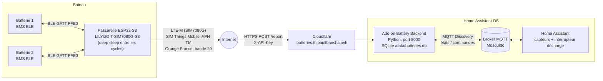
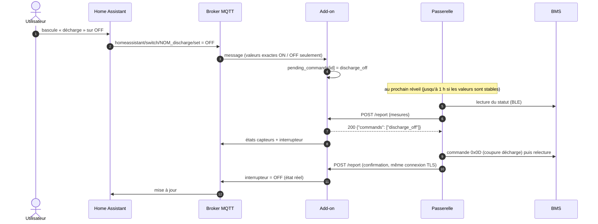
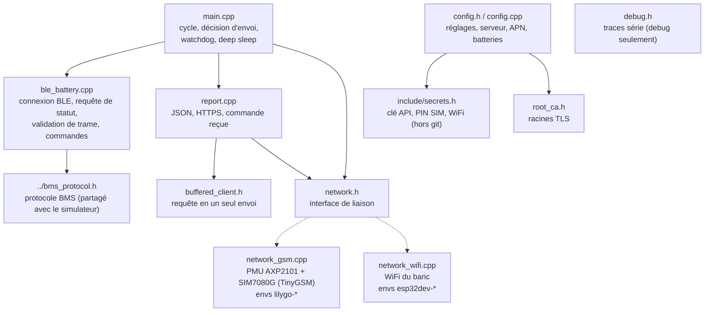
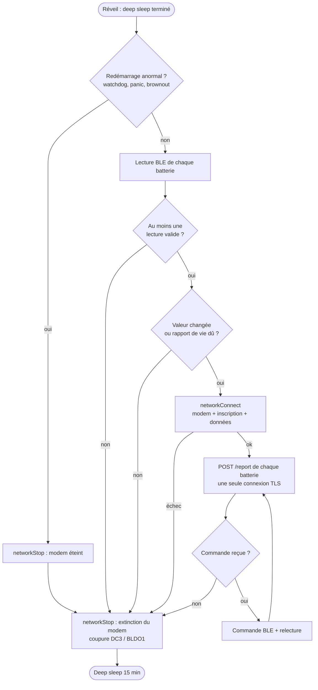
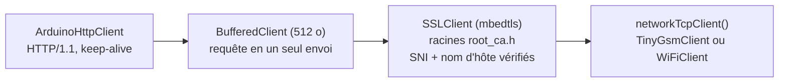
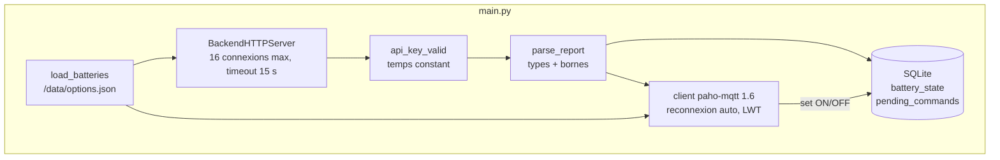

# Architecture — Gestion des batteries du bateau

Vue d'ensemble technique du système : composants, flux de données, cycle de la passerelle,
sécurité, énergie et réglages qui doivent rester cohérents entre eux.
L'état d'avancement, l'historique et les problèmes connus sont dans [CONTEXT.md](CONTEXT.md) ;
les conventions de développement dans [CLAUDE.md](CLAUDE.md).

---

## 1. Vue d'ensemble

Surveiller et piloter les batteries LiFePO4 (PowerQueen / LiTime, BMS Bluetooth) d'un bateau
depuis Home Assistant, sans WiFi à bord : la passerelle se réveille, lit les batteries en
Bluetooth, remonte les mesures par le réseau cellulaire LTE-M, puis se rendort.



| Composant | Rôle | Code |
|---|---|---|
| BMS de la batterie | Fournit l'état (tension, courant, SOC, SOH, décharge) et accepte les commandes de coupure / rétablissement de la décharge | protocole dans `Embedded/bms_protocol.h` |
| Passerelle ESP32 | Lit les BMS en BLE, envoie les rapports en HTTPS, applique les commandes reçues | `Embedded/esp32_gateway/` (PlatformIO) |
| Cloudflare | Proxy HTTPS public devant l'add-on (certificat Google Trust Services ou Let's Encrypt) | — |
| Add-on Battery Backend | Valide et stocke les rapports, publie les entités dans HA, garde les commandes en attente | `Battery Backend/` |
| Home Assistant | Affichage, historique, automatisations, interrupteur « décharge » | — |
| Simulateur (banc) | Second ESP32 qui imite un BMS en BLE | `Embedded/esp32_battery_simulator/` |

---

## 2. Modèle de communication

**Pas de connexion entrante vers le bateau.** C'est toujours la passerelle qui appelle le serveur.
Une commande saisie dans Home Assistant est mise en attente par l'add-on et livrée dans la
**réponse** au prochain rapport (modèle « pull »).



### API HTTP de l'add-on

| Méthode | Chemin | Authentification | Rôle |
|---|---|---|---|
| `POST` | `/report` | en-tête `X-API-Key` | Rapport d'une batterie ; réponse `{"commands": [...]}` |
| `GET` | `/status` | en-tête `X-API-Key` | Dernier état connu de chaque batterie |
| `GET` | `/health` | aucune | Vivacité (watchdog du Supervisor) |

Corps d'un rapport :

```json
{"battery_mac": "AA:BB:CC:DD:EE:FF", "voltage_v": 13.24, "current_a": -2.51,
 "soc_pct": 72, "soh_pct": 98, "discharge_off": false}
```

`battery_mac` est l'identifiant de la batterie (`reportId` côté passerelle, `id` dans l'option
`batteries` de l'add-on), pas forcément une vraie adresse MAC.

### Sujets MQTT (par batterie `<nom>`)

| Sujet | Contenu |
|---|---|
| `homeassistant/sensor/<nom>_{voltage,current,soc,soh}/config` | Découverte des 4 capteurs (retenu) |
| `homeassistant/sensor/<nom>/state` | JSON des mesures |
| `homeassistant/switch/<nom>_discharge/{config,state,set}` | Interrupteur « décharge » (`ON` = décharge active) |
| `battery_backend/status` | `online` / `offline` (LWT) : disponibilité de toutes les entités |

---

## 3. Passerelle ESP32

### 3.1 Modules



Un seul transport est compilé, choisi dans `platformio.ini` (`-DNETWORK_GSM` ou
`-DNETWORK_WIFI`). Tout ce qui est au-dessus de `network.h` est identique pour les deux : le
banc WiFi teste le même code HTTPS que le bateau.

| Environnement | Carte | Liaison | Traces série |
|---|---|---|---|
| `lilygo-debug` (défaut) | LILYGO T-SIM7080G-S3 | LTE-M | oui |
| `lilygo-release` | LILYGO T-SIM7080G-S3 | LTE-M | non |
| `esp32dev-debug` | ESP32 classique (banc) | WiFi | oui |
| `esp32dev-release` | ESP32 classique (banc) | WiFi | non |

### 3.2 Cycle de réveil



- Jusqu'à `MAX_ROUNDS = 3` tours « rapport → commande → confirmation » par cycle.
- La durée d'un cycle est bornée par un watchdog (`MAX_CYCLE_DURATION_S` : 420 s en LTE-M,
  180 s en WiFi). Après un redémarrage anormal, le cycle est sauté pour éviter une boucle de
  redémarrages qui viderait la batterie.
- Dernières valeurs envoyées et compteur de cycles en mémoire RTC (conservée en deep sleep).

### 3.3 Lecture BLE

1. Connexion à l'adresse BLE (2 essais), découverte du service `FFE0`, abonnement aux
   notifications `FFE1`, pause de 200 ms.
2. Écriture de la requête de statut sur `FFE2` : `00 00 04 01 13 55 AA 17`.
3. Réassemblage des notifications (tampon 256 octets), trame complète après 150 ms de silence
   et au moins 104 octets ; nouvel essai de la requête si rien n'arrive en 4 s.
4. Validation : marqueur `0x65`, checksum (somme des octets), bornes physiques
   (≤ 70 V, |courant| ≤ 1000 A, SOC / SOH ≤ 100).

Offsets de la trame (little-endian) : tension mV @12, cellules @16, courant mA @48, état @68
(bit `0x80` = décharge coupée), SOC @90, SOH @92. **Pas encore validés sur la vraie batterie.**

### 3.4 Liaison LTE-M (`network_gsm.cpp`)

```mermaid
sequenceDiagram
    participant E as ESP32
    participant P as PMU AXP2101
    participant M as SIM7080G
    participant R as Réseau Orange (LTE-M)

    E->>P: DC3 = 3,0 V (modem), BLDO1 = 3,3 V (niveaux)
    E->>M: test AT ; sinon impulsion PWRKEY (GPIO 41)
    E->>M: AT+CPIN? (PIN optionnel, jamais retenté après refus)
    E->>M: CFUN=0, CNMP=38 (LTE), CMNB=1 (LTE-M), CGDCONT/CNCFG APN "TM", CFUN=1
    M->>R: inscription (itinérance acceptée, ≤ 90 s)
    E->>M: AT+CNACT=0,1 (liaison de données, ≤ 30 s)
    Note over E,M: TCP via AT+CAOPEN / CASEND / CARECV<br/>TLS fait par l'ESP32 au-dessus
    E->>M: AT+CPOWD=1 (extinction propre)
    E->>P: coupure DC3 et BLDO1
```

Broches LILYGO T-SIM7080G-S3 (exemples officiels LilyGO) : UART modem RX = GPIO 4,
TX = GPIO 5 ; PWRKEY = GPIO 41 ; DTR = GPIO 42 ; PMU en I2C SDA = 15 / SCL = 7.

### 3.5 Pile HTTPS (`report.cpp`)



- Le TLS est fait par l'ESP32, jamais par le modem : même vérification qu'en WiFi, aucun
  certificat à charger dans le modem.
- Racines acceptées : GTS Root R1 / R4 et ISRG Root X1 / X2 (Cloudflare alterne entre Google
  Trust Services et Let's Encrypt).
- SSLClient sans délai de lecture (`setHandshakeTimeout` seulement) : sinon il attend des
  enregistrements TLS entiers que le client TinyGSM n'annonce jamais.
- Une connexion par cycle, réutilisée par tous les rapports du cycle ; un nouvel essai si le
  serveur l'a fermée.

---

## 4. Add-on Battery Backend



| Élément | Détail |
|---|---|
| Options | `api_key` (masquée), `sensor_expire_after` (10800 s), `batteries` (liste `id` / `name`) |
| Validation | tension 0-70 V, courant ±1000 A, SOC / SOH entiers 0-100, `discharge_off` booléen, corps ≤ 4 Ko |
| Base | `battery_state` (dernier état), `pending_commands` (une commande en attente par batterie) |
| Entités HA | 4 capteurs avec `state_class`, `expire_after`, `availability_topic` ; 1 interrupteur |
| Robustesse | démarre sans broker, reconnexion MQTT, arrêt propre sur SIGTERM, watchdog sur `/health` |
| Tests | `Battery Backend/tests/test_backend.py` (sans broker) |

---

## 5. Sécurité

| Menace | Protection |
|---|---|
| Interception / falsification du trafic | HTTPS vérifié par l'ESP32 (chaîne + nom d'hôte), Cloudflare devant l'add-on |
| Rapport ou commande forgés | Clé API (`X-API-Key`) comparée en temps constant, exigée sur `/report` et `/status` |
| Données invalides ou malveillantes | Validation stricte côté add-on ; trames BLE filtrées côté passerelle |
| Injection dans les sujets MQTT | Noms de batteries limités à `[a-z0-9_]` ; identifiants à `[A-Za-z0-9:_-]` |
| Valeur MQTT inattendue | Seuls `ON` / `OFF` déclenchent une commande |
| Saturation du serveur | Corps ≤ 4 Ko, 16 connexions max, timeout de 15 s, logs échappés |
| Fuite de secrets | `include/secrets.h` hors git ; `api_key` masquée dans l'interface de l'add-on |
| Blocage de la SIM | Code PIN jamais retenté après un refus |
| Limites connues | BLE du BMS sans appairage ; pas de limitation des essais de clé par IP (IP de Cloudflare) |

---

## 6. Énergie et data

La passerelle est alimentée par le bord et le forfait LTE-M est facturé au Mo.

| Mesure | Effet |
|---|---|
| Deep sleep de 15 min entre les cycles | ESP32 et modem hors tension la plupart du temps |
| Modem allumé seulement s'il y a quelque chose à envoyer | Pas de radio si aucune batterie lue ou valeurs stables |
| Rapport seulement si changement (≥ 0,05 V, ≥ 1 A, ≥ 1 point de SOC, SOH, état de décharge) ou rapport de vie toutes les heures | Un seul envoi par heure quand rien ne bouge |
| Une connexion TLS par cycle, non fermée explicitement | Une négociation (~4 Ko) par cycle au lieu d'une par rapport |
| Requête HTTP en un seul envoi, valeurs à 2 décimales | Moins d'échanges AT et d'octets |
| Extinction propre du modem puis coupure de son alimentation | Pas de consommation du modem pendant la veille |
| Délais bornés + watchdog | Pas de cycle bloqué qui viderait la batterie |
| Firmware `*-release` | Aucune trace série, pas de pause au démarrage |

Ordre de grandeur, valeurs stables : un rapport par heure, environ 0,1 Mo/jour (estimation à
confirmer sur le portail Things Mobile).

---

## 7. Réglages liés entre eux

Ces valeurs sont réparties entre la passerelle et l'add-on et doivent être modifiées ensemble.

| Réglage passerelle (`config.h` / `config.cpp`) | Réglage add-on | Règle |
|---|---|---|
| `reportId` de chaque entrée de `BATTERIES[]` | `id` de l'option `batteries` | Identiques, sinon rapport refusé (404) |
| `SECRET_API_KEY` (`include/secrets.h`) | option `api_key` | Identiques, longue et aléatoire |
| max(`REPORT_HEARTBEAT_S`, `CYCLE_INTERVAL_MS`) = 1 h | `GATEWAY_MAX_REPORT_GAP_S` (`main.py`) | Identiques |
| idem | option `sensor_expire_after` (10800 s) | Nettement supérieure, sinon capteurs « indisponible » entre deux rapports |
| `MAX_VOLTAGE_V`, `MAX_CURRENT_A`, SOC / SOH ≤ 100 | `LIMITS` (`main.py`) | Identiques |
| `SERVER_HOST`, `SERVER_PATH` | URL publique de l'add-on via Cloudflare | Cohérentes |
| `root_ca.h` | autorité du certificat Cloudflare | La racine de la chaîne présentée doit y figurer |

---

## 8. Arborescence

```
HA-Batterie-backend-addons/
├── ARCHITECTURE.md            # ce document
├── CONTEXT.md                 # état, historique, problèmes connus, feuille de route
├── CLAUDE.md                  # conventions et commandes
├── repository.yaml            # dépôt d'add-ons Home Assistant
├── Battery Backend/           # add-on (config.yaml, Dockerfile, run.sh, main.py, tests/, CHANGELOG.md)
└── Embedded/
    ├── bms_protocol.h         # protocole BMS partagé
    ├── esp32_gateway/         # passerelle PlatformIO (platformio.ini, include/, src/)
    ├── esp32_battery_simulator/   # faux BMS BLE (Arduino IDE)
    └── test_http_report_mock/     # test HTTP en WiFi (Arduino IDE)
```
